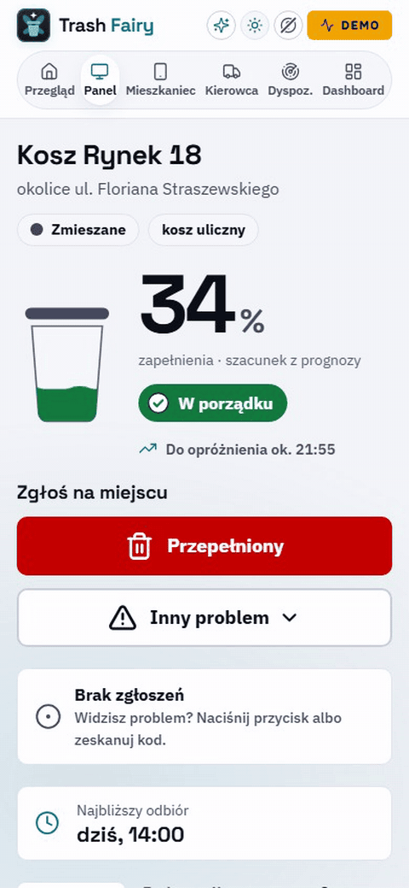

# Trash Fairy

**Planowanie odbioru koszy ulicznych według zapełnienia, a nie stałego harmonogramu: dla operatora odbioru odpadów, jego dyspozytorów i kierowców oraz mieszkańców, którzy zgłaszają przepełnione kosze.**

 <DO UZUPEŁNIENIA: nagram>

📹 [Prezentacja działania — 2 min](<DO UZUPEŁNIENIA: link YouTube>)

**Demo:** https://trashfairy.twapp.pl. Bez logowania, na danych demonstracyjnych. Przycisk „Resetuj dane demo” przywraca stan wyjściowy.

## Problem → rozwiązanie

Kosze w centrum miasta są opróżniane według stałego planu. W symulacji 57% przyjazdów trafia na kosz zapełniony poniżej połowy, a mimo to kosze przepełniają się w weekendy i przy wydarzeniach.
Trash Fairy zbiera tanie sygnały (przycisk i dzienny kod QR na koszu, poziom zastany przez kierowcę), prognozuje godzinę zapełnienia i wybiera na kurs tylko te kosze, które nie doczekają następnego kursu.
Decyzje podejmują jawne reguły w kodzie, a AI tylko opisuje zdjęcia.
Wynik w symulacji 4 tygodni na tym samym przebiegu zapełniania:
- puste przyjazdy spadają z 57% do 27%;
- odbiorów koszy jest o 24% mniej;
- altany nie przepełniają się wcale (338 h → 0 h).

## Dokumentacja analityczna

| Dokument | Co zawiera |
|---|---|
| [01. Problem i zakres](docs/01-problem-i-zakres.md) | problem z liczbami, interesariusze, miary sukcesu, co w zakresie i co świadomie poza nim |
| [02. Proces](docs/02-proces.md) | proces przed i po (diagramy), aktorzy, 9 punktów decyzyjnych z regułami |
| [03. User flow](docs/03-user-flow.md) | mapa 18 ekranów i 6 modali z przejściami (3 diagramy według ról), tabela ekranów, ślepe ścieżki |
| [04. Model danych](docs/04-model-danych.md) | diagram ER, encje, reguły integralności: co pilnuje baza, a co kod |
| [05. Wymagania](docs/05-wymagania.md) | 38 wymagań z kryteriami akceptacji, każde z miejscem w kodzie i testem |
| [06. Decyzje](docs/06-decyzje.md) | 10 kluczowych decyzji: kontekst, opcje, wybór, skutki |
| [07. Ograniczenia](docs/07-ograniczenia.md) | czego nie ma i dlaczego, znane problemy z plikiem i linią, rozbieżności dokumentacji, warunki pilotażu |

Materiały źródłowe:
- [`docs/KONCEPCJA.md`](docs/KONCEPCJA.md): koncepcja sprzed pisania kodu;
- [`docs/kontekst-mpo.md`](docs/kontekst-mpo.md): jak działa odbiór dziś;
- [`DECYZJE.md`](DECYZJE.md): pełny chronologiczny dziennik decyzji;
- [`ROADMAPA.md`](ROADMAPA.md): plan pilotażu;
- `/metodologia` w aplikacji: wszystkie założenia i progi, czytane wprost z kodu.

## Jak uruchomić

Komendy sprawdzone od zera na świeżym klonie (Windows 11, Python 3.13, Docker 28).

**Docker (aplikacja + PostgreSQL 16):**
```bash
docker compose up --build        # http://localhost:8080
```
Pierwszy start trwa ok. 2 minuty, bo aplikacja sama importuje punkty i symuluje 8 tygodni. Dopiero potem `/health` zwraca `ok`.

**Lokalnie (SQLite):**
```bash
python -m venv .venv
.venv\Scripts\activate             # Windows; Git Bash: source .venv/Scripts/activate; Linux/macOS: source .venv/bin/activate
pip install -r requirements.txt -r requirements-dev.txt
flask --app app seed               # punkty z data/*.geojson + 8 tygodni symulacji, ok. 45 s
flask --app app run                # http://localhost:5000; pierwsze wejście na / liczy porównanie (do 20 s)
python -m pytest -q -n auto        # 459 testów, ok. 3 min
```
- Na Windows trzymaj klon w krótkiej ścieżce, np. `C:\dev\trash-fairy`. Pakiet `anthropic` ma bardzo długie nazwy plików i bez włączonych długich ścieżek `pip install` kończy się błędem `OSError: No such file or directory`.
- Zmienne środowiskowe są opcjonalne: wzór w [`.env.example`](.env.example), skopiuj go do `.env`. Bez klucza API aplikacja działa w pełni, a zdjęcia dostają status „Do weryfikacji”.

## Stack i dlaczego taki

| Element | Dlaczego |
|---|---|
| **Python 3.12 + Flask** (app factory, blueprinty) | Mała aplikacja z kilkoma ekranami i API. Flask nie narzuca struktury, a OR-Tools i biblioteki danych są w Pythonie. |
| **Jinja + własny CSS, bez builda i CDN** | Jedna komenda uruchamia całość, a demo nie zależy od zewnętrznych serwerów. Biblioteki i fonty leżą w `app/static/vendor` ([06-decyzje.md](docs/06-decyzje.md), D10). |
| **SQLAlchemy: SQLite lokalnie, PostgreSQL na produkcji** | Zero konfiguracji do uruchomienia i testów (każdy test ma własną bazę w pamięci), a produkcja na tym samym modelu. |
| **Google OR-Tools** (VRP z pojemnością) | Trasy dla kilku pojazdów z limitem ładunku, deterministycznie i powtarzalnie w testach (D3). |
| **Leaflet + OpenStreetMap** | Otwarte dane prawdziwych koszy i otwarta mapa, bez klucza i kosztów (D9). |
| **Claude API** (tylko przez `app/llm.py`) | Opis zdjęć i wydarzeń z walidacją schematu. Nie podejmuje decyzji, a błąd API nie zatrzymuje aplikacji (D1, D6). |
| **Gunicorn + Docker** | Jeden kontener plus baza. `/health` sprawdza połączenie z bazą. |
| **pytest + ruff + GitHub Actions** | 459 testów i lint przy każdym PR. Kluczowe liczby (57% → 27%, −24%) pilnuje test regresji. |

## Zakres i ograniczenia

| Prawdziwe | Symulowane |
|---|---|
| Położenia koszy i altan z OpenStreetMap | Poziomy zapełnienia koszy |
| Publiczny harmonogram oczyszczania 08/2026 | Historia 12 miesięcy, koszty, masy i projekty na dashboardzie |
| Wydarzenia (Karnet Kraków), pogoda (Open-Meteo) | Urządzenia i telemetria |
| Reguły, prognoza i trasy OR-Tools | Położenie mieszkańca w demo |

Świadomie poza zakresem: logowanie i role, czujnik zapełnienia jako wejście do decyzji, rejestracja mieszkańca przez SMS, przyjmowanie zgłoszeń przez Open311.
Kwoty (12 zł za odbiór, 5 zł/km) to założenia do potwierdzenia z przewoźnikiem.
Pełna lista ze znanymi problemami (plik i linia): [07. Ograniczenia](docs/07-ograniczenia.md).

## Dane i licencja

- © OpenStreetMap contributors (ODbL 1.0).
- Harmonogram oczyszczania: [mpo.krakow.pl/czystosc](https://mpo.krakow.pl/czystosc/).
- Wydarzenia: Karnet Kraków (Krakowskie Biuro Festiwalowe).
- Atrybucje bibliotek: [NOTICE](NOTICE).
- Kod na licencji [GNU AGPL-3.0](LICENSE).

Kod powstał z pomocą Claude Code. Każdy etap zaczynał się od planu zaakceptowanego przez autora, a uzasadnienia są w [`DECYZJE.md`](DECYZJE.md).

## Kontekst projektu

Projekt powstał solo na hackathonie **HackYeah 2026** (3–4.10.2026) w zadaniu otwartym **Smart City**: „rozwiąż konkretny problem miasta lub jego mieszkańców, wskaż użytkowników i pokaż, jak rozwiązanie działa w konkretnej sytuacji”. Z obszarów podanych w zadaniu wybrałem zarządzanie odpadami i wykorzystanie danych miejskich do podejmowania decyzji. Treść zadania i regulamin: [`docs/zadanie/`](docs/zadanie/).
Koncepcja powstała przed wydarzeniem ([`docs/KONCEPCJA.md`](docs/KONCEPCJA.md), bez kodu). Rdzeń aplikacji napisałem podczas hackathonu, a po nim (5–6.10) domknąłem podpowiedzi, scenariusze demo i filmy.

**Ocena w pierwszej fazie (komisja zadania, platforma HackTribe):**

| Pomysł i innowacyjność (30%) | Zgodność z kategorią (20%) | Użyteczność (20%) | Design (20%) | Kompletność i gotowość wdrożenia (10%) | Średnia ważona | Średnia wszystkich zespołów |
|---|---|---|---|---|---|---|
| 6,25 | 7,00 | 4,50 | 6,25 | 4,25 | **5,85** | 4,66 |

Najniżej oceniono użyteczność i kompletność wdrożenia.

**Czego się nauczyłem:** <DO UZUPEŁNIENIA>

Materiały z hackathonu:
- [film 3 min](demo/demo_trash-fairy_3min.mp4);
- [film 8 min](demo/demo_trash-fairy_pelne.mp4);
- [slajdy PDF](demo/prezentacja_trash-fairy.pdf);
- [scenariusz pokazu](DEMO.md).

---

**English:** Trash Fairy plans street-bin pickups by forecast fill level instead of a fixed schedule. In a 4-week simulation on identical fill data, empty trips drop from 57% to 27% and bin pickups by 24%. Decisions are explicit rules in code; AI only describes photos. Analysis docs (Polish) are in [`docs/`](docs/01-problem-i-zakres.md).
