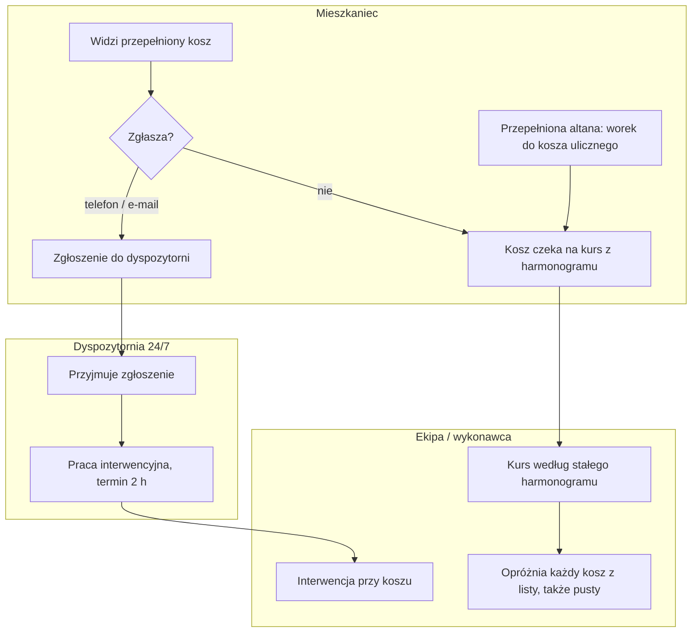
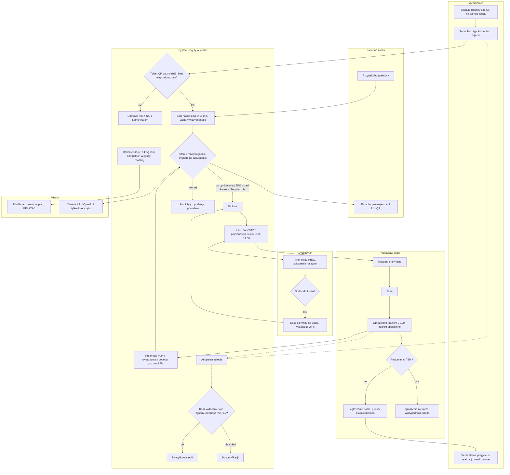

# 02. Proces biznesowy: przed i po

## Aktorzy

| Aktor | Rola w procesie |
|---|---|
| Mieszkaniec | widzi problem przy koszu i go zgłasza |
| Panel na koszu | przycisk „Przepełniony”, ekran e-papierowy z dziennym kodem QR, telemetria |
| System (reguły w kodzie) | łączy zgłoszenia, liczy stan i prognozę, wybiera kosze na kurs, układa trasę |
| Dyspozytor | reaguje na pilne kosze, ręcznie dokłada kosz do kursu |
| Kierowca / ekipa | jedzie trasą, oznacza „Jadę” i „Opróżniono”, zgłasza problemy i wysypiska |
| Miasto / operator | ocenia koszty wobec planu i decyduje o inwestycjach |

## PRZED: stały harmonogram

Źródła: [`kontekst-mpo.md`](kontekst-mpo.md) (organizacja i harmonogram) oraz model bazowy w symulacji
([`app/simulation.py`](../app/simulation.py), [`app/comparison.py`](../app/comparison.py): wszystkie kosze o 6:00 i 14:00, altany co 3 dni).

Słabe punkty procesu PRZED:
1. **Decyzja o przyjeździe nie zależy od zapełnienia.** W modelu 57% przyjazdów trafia na kosz zapełniony poniżej połowy.
2. **Zgłoszenie jest kosztowne dla mieszkańca** (telefon, e-mail), więc większość przepełnień nie jest zgłaszana.
3. **Brak sprzężenia zwrotnego:** nikt nie zapisuje, ile było w koszu przy opróżnieniu, więc harmonogramu nie da się poprawić danymi.

**Założenie, niezweryfikowane z MPO:** dyspozytornia przekazuje zgłoszenie ekipie lub wykonawcy telefonicznie, a ekipa nie zapisuje
poziomu zastanego w koszu. Opis harmonogramu i dyspozytorni pochodzi z publicznych materiałów MPO. Weryfikacja: rozmowa z dyspozytorem
w tygodniu 0–2 pilotażu ([`ROADMAPA.md`](../ROADMAPA.md)).

## PO: Trash Fairy

## Punkty decyzyjne

| # | Decyzja | Kto decyduje | Reguła | Kod |
|---|---|---|---|---|
| 1 | Czy przyjąć zgłoszenie z telefonu? | system | ważny dzienny token QR kosza i limit (1/min na telefon i kosz, 200/h z IP) | `app/api_pl.py:24-50, 140-151` |
| 2 | Nowe zgłoszenie czy dołączenie do istniejącego? | system | naciśnięcia w 15 min od pierwszego tworzą jedno zgłoszenie | `app/reports.py:49-76` |
| 3 | Ile waży zgłoszenie? | system | wiarygodność przycisku (trafne z ostatnich 10, start 70%), osłabienia antyspamowe | `app/reports.py:14-24`, `app/state.py:67-86` |
| 4 | Jaki jest stan kosza? | system | max(prognoza, 100 × waga); „do opróżnienia” > 85% albo świeże silne zgłoszenie | `app/state.py:20-51, 223` |
| 5 | Czy kosz jedzie w tym kursie? | system | stan „do opróżnienia”, albo 85% przed kolejnym kursem, albo bezpiecznik 3/7 dni | `app/routes.py:26-31, 66-75` |
| 6 | Czy dołożyć kosz poza regułą? | dyspozytor | „Dodaj do kursu”: kosz jedzie pierwszy, decyzja wygasa po opróżnieniu lub 24 h | `app/routes.py:34-49, 172-175` |
| 7 | Czy zgłoszenie było trafne? | system na podstawie danych kierowcy | poziom przy opróżnieniu ≥ 75% | `app/reports.py:13, 79-90` |
| 8 | Czy zdjęcie potwierdza zgłoszenie? | system (AI opisuje, reguła ocenia) | kosz widoczny, stan zgodny z typem, pewność ≥ 0,7; AI nigdy nie odrzuca | `app/photos.py:92-121` |
| 9 | Co zmienić w infrastrukturze? | miasto, na podstawie rekomendacji | kompaktor / większy kosz / rzadziej z danych z 4 tygodni | `app/recommendations.py:11-60` |

## Wejścia i wyjścia

| Wejścia | Wyjścia |
|---|---|
| naciśnięcia przycisku, zgłoszenia z QR, zdjęcia | stan i prognoza każdego kosza (z powodem słownym) |
| poziom przy opróżnieniu i zdjęcia od ekipy | trasa na kurs, z listą pominiętych i powodami |
| położenia koszy z OpenStreetMap | status zgłoszenia dla mieszkańca, punkty |
| wydarzenia (Karnet Kraków), pogoda (Open-Meteo), ruch (TomTom) | rekomendacje inwestycyjne, KPI, eksport CSV, otwarte API |
