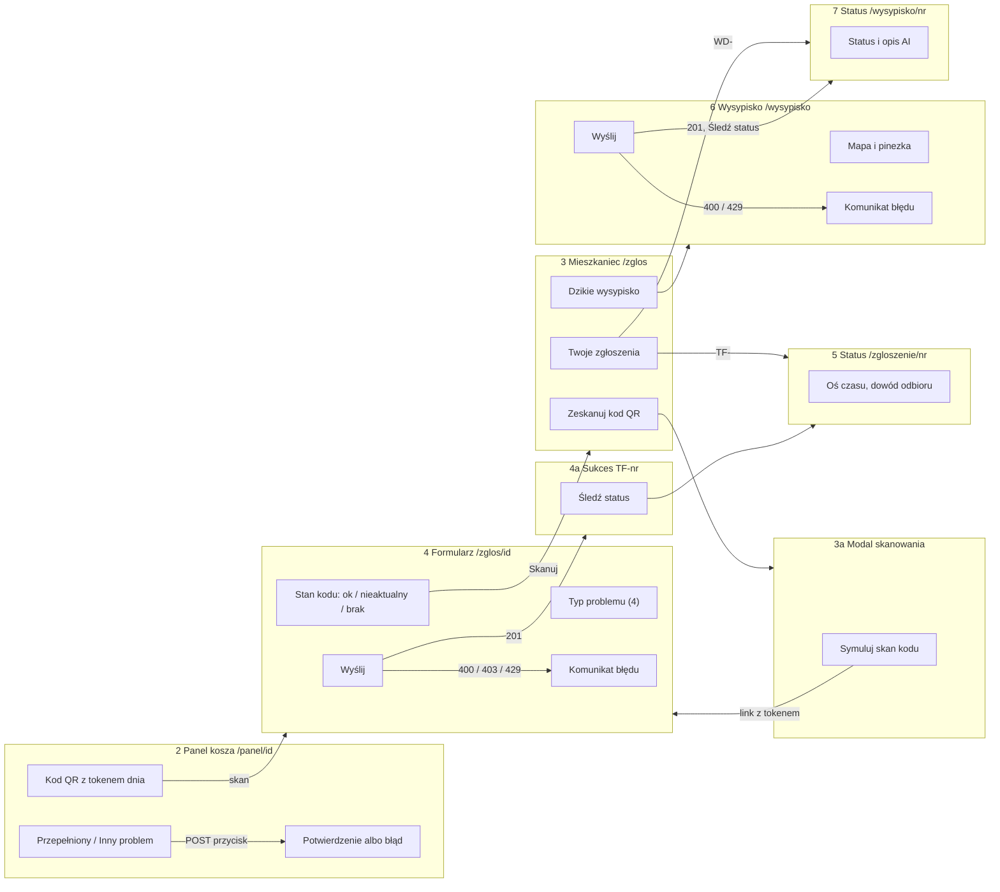
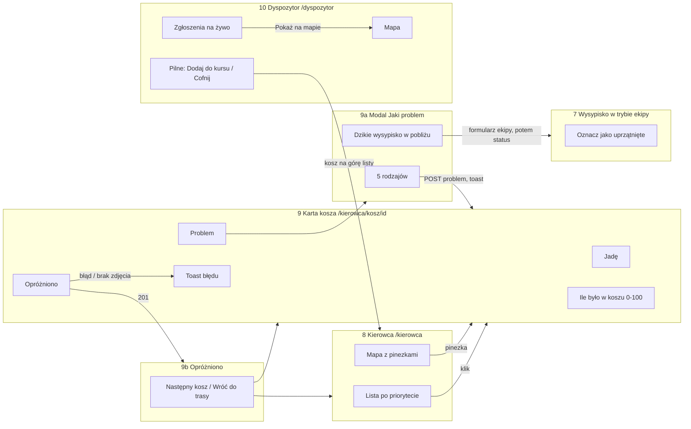
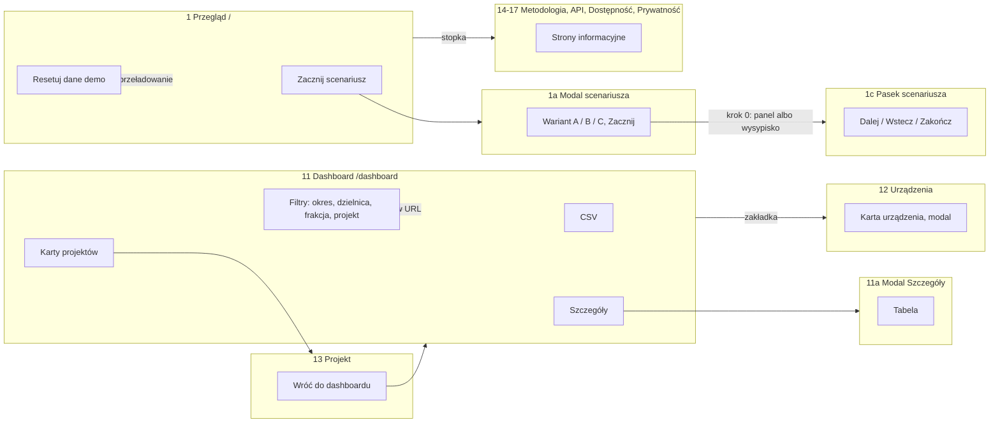

# 03. User flow: mapa ekranów i przejść

**Ról i logowania nie ma** (`app/ui.py:1`, `app/api_pl.py:69`). „Rola” to perspektywa w przełączniku nagłówka (`templates/ui/base.html:29-40`). Tożsamości demo są zaszyte na stałe: „Anna K.”, „Ekipa MPO” (`?ekipa=1`), „trasa K-07”. Logowanie istniało i zostało świadomie usunięte (`DECYZJE.md:340,355`; `/logowanie` przekierowuje 301 na `/`, `views.py:69-79`). Dostępu bronią tylko tokeny: dzienny QR (403 `brak_skanu_qr`) i token panelu (403).

## Diagram 1 — mieszkaniec

## Diagram 2 — kierowca i dyspozytor

## Diagram 3 — miasto, strony publiczne, scenariusz demo

## Tabela ekranów

| Nr | Ekran | Elementy | Akcja użytkownika | Prowadzi do |
|---|---|---|---|---|
| 1 | Przegląd `/` | 3 liczby, „Zacznij scenariusz”, 4 kafle perspektyw, „Resetuj dane demo” | Zacznij / kafel / Reset | 1a, 2, 3, 8, 11, 1b |
| 1a | Modal scenariusza | wariant A/B/C, Losuj ponownie, Zacznij | Zacznij / X / Esc | A, B → 2; C → 6; zamknięcie → 1 |
| 1b | Modal resetu | Anuluj, Przywróć dane | Przywróć | toast i przeładowanie; 429 → toast błędu |
| 1c | Pasek scenariusza (każda strona) | krok i z N, Wstecz, Dalej, X | Dalej / Zakończ / X | kolejny krok / 1 / ukrycie |
| 2 | Panel kosza `/panel/<id>` | poziom, prognoza, najbliższy odbiór, QR, Przepełniony / Inny problem | przycisk; skan QR | komunikat 10 s; 4 |
| 3 | Mieszkaniec `/zglos` | Zeskanuj QR, Dzikie wysypisko, Twoje zgłoszenia (localStorage), punkty | Skanuj / wysypisko / wiersz | 3a, 6, 5, 7 |
| 3a | Modal skanu | wizjer, Symuluj skan, Losuj inny | Symuluj | 4 z tokenem |
| 4 | Formularz `/zglos/<id>?qr=` | stan kodu QR, 4 typy, komentarz, zdjęcie, błąd, Wyślij z powodem blokady | Wyślij | 4a; błąd 400/403/429 w alercie; brak kodu → 3 |
| 4a | Sukces | numer TF-, punkty, Śledź status, Wróć | linki | 5, 2/3, 1 |
| 5 | Status `/zgloszenie/<nr>` | oś czasu 3 kroki, dowód odbioru, AI | wstecz | 3; nieznany numer → karta z linkiem do 3 |
| 6 | Wysypisko `/wysypisko` | mapa, GPS, rodzaje, ilość, zdjęcie, Wyślij | Wyślij | 6a; błąd 400/429 w alercie; błąd GPS opisany |
| 6a | Sukces WD- | numer, status, Śledź | link | 7 |
| 7 | Status `/wysypisko/<nr>` | status, fakty, zdjęcie; w trybie ekipy „Uprzątnięte” | Uprzątnięte | toast; 409, gdy już uprzątnięte |
| 8 | Kierowca `/kierowca` | postęp kursu, mapa, lista po priorytecie, pominięte z powodem | wiersz / pinezka | 9 |
| 9 | Karta kosza | mapa, stan, zgłoszenia + AI, poziom 0–100, zdjęcie, Jadę / Opróżniono / Problem | Jadę / Opróżniono / Problem | toast; 9b; 9a |
| 9a | Modal problemu | 5 rodzajów, link do wysypiska | rodzaj / link | toast; 6 w trybie ekipy |
| 9b | Opróżniono | podsumowanie, dowód, następny kosz | klik | 9 / 8 / krok scenariusza |
| 10 | Dyspozytor `/dyspozytor` | mapa, KPI, Pilne / Ekipy i trasy / Zgłoszenia | Dodaj do kursu / Cofnij / Pokaż na mapie | toast; kosz na górze w 8 |
| 11 | Dashboard `/dashboard` | filtry, 9 KPI, wykresy, rekomendacje, kolejka napraw, projekty, 3 CSV, Drukuj PDF | filtr / Szczegóły / projekt / CSV / druk | 11 (URL), 11a, 13, plik |
| 11a | Modal Szczegóły | tabela danych | X / Esc | 11 |
| 12 | Urządzenia | filtry, karty, modal z danymi urządzenia | karta | 12a → 2 |
| 13 | Projekt `/dashboard/projekty/<slug>` | fakty, 5 wykresów przed i po | wstecz (filtry zachowane) | 11 |
| 14–17 | Metodologia, Otwarte API, Dostępność, Prywatność | tekst, tabele, linki | linki | 11, JSON/CSV |
| 18 | 404 / 413 / 500 | komunikat, Przegląd, Twoje zgłoszenia | klik | 1, 3 |

Scenariusze demo (`app.js:159-179`):
- **A:** 2 → 4 → 2 → 10 → 8 → 9 → 5 → 11
- **B:** 2 (przycisk) → 10 → 8 → 9 → 2 → 11
- **C:** 6 → 7 → 10 → 7 (ekipa) → 3

## Ścieżki ślepe i akcje bez informacji zwrotnej

1. ~~**Projekt, który nie istnieje.**~~ *Naprawione 11.10.2026.* `projekt.js:23` czeka na kod `projekt_nie_istnieje`, a API zwraca `nieznany_projekt` (`dashboard_api.py:468`). Karta „Nie ma takiego projektu” nigdy się nie pokazuje: jest toast, a szkielety ładowania wiszą bez końca. *(potwierdzone)*
2. ~~**Pierwsze ładowanie nie ponawia się po błędzie.**~~ *Naprawione: `TF.watch` odświeża co ok. 30 s.* `TF.watch` przy błędzie tylko woła `onState(false)` (`app.js:107`). Kierowca, karta kosza, dyspozytor i dashboard zostają w stanie błędu bez przycisku „Spróbuj ponownie”. Ponowienie mają tylko Urządzenia (`urzadzenia.js:172-176`).
3. ~~**Statusy zgłoszeń obsługują wyłącznie 404.**~~ *Naprawione: komunikat przy innym błędzie.* Na innym błędzie oba ekrany statusu milczą (`mieszkaniec.js:187`, `wysypisko.js:197-199`). Do tego `/zgloszenie` odpytuje dalej nawet po „nie znaleziono”.
4. ~~**Dashboard przy sprzecznych filtrach**~~ *Naprawione: nieaktualne liczby wyszarzone.* pokazuje toast, ale zostawia stare liczby pod nowymi filtrami w URL (`dashboard.js:27-35,354`).
5. ~~**Eksport CSV przy błędnym filtrze**~~ *Naprawione: eksport wyłączony do czasu poprawnego filtra.* pobiera plik z JSON-em błędu zamiast danych (`dashboard.html:20-22`).
6. **Dyspozytor nie może przejść do szczegółów.** Brak przejścia do zgłoszenia TF- ani do wysypiska WD- i brak akcji na wysypiskach, choć ekran sukcesu obiecuje „trafia do dyspozytora” (`wysypisko.js:146`).
7. **„Skanuj” na formularzu bez kodu gubi kosz.** Symulowany skan losuje inny kosz (`zglos.html:23`, `mieszkaniec.js:31-35`).
8. **OSRM niedostępny.** Trasa rysuje się linią prostą bez informacji dla użytkownika (`kierowca.js:181`).

Prawdziwego ekranu bez wyjścia nie ma. Pełnoekranowy panel ma link „Przegląd” w rogu (`kiosk.html:16`).

---
