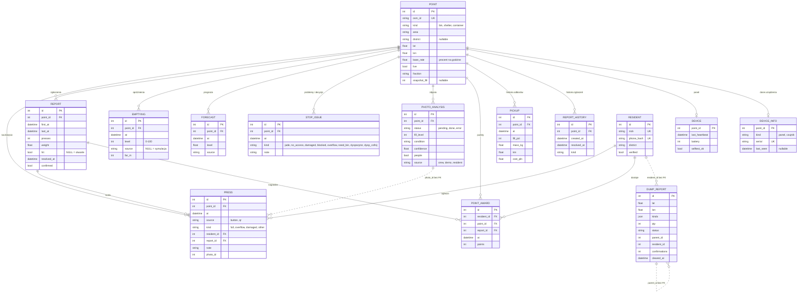

# 04. Model danych

20 tabel, Flask-SQLAlchemy, bez Alembica (brakujące kolumny dodaje `ALTER TABLE` przy starcie, `app/__init__.py:127-142`).
**Brak `db.relationship`, `CheckConstraint` i `Enum`** — relacje tylko przez FK, słowniki to wolne `String`.
Czas: naiwny „zegar demo” (`models.py:3-4`), a kolumny `wall_at` w UTC.

## Encje (rdzeń)

| Encja | Rola | Kluczowe atrybuty | Linia |
|---|---|---|---|
| `point` | kosz (`bin`) / altana śmietnikowa (`shelter`) / `container` | osm_id UK, kind, area, district, lat/lon, base_rate (tempo %/h), live, fraction, snapshot_fill | `models.py:7-34` |
| `press` | jedno naciśnięcie / zgłoszenie z QR | point_id FK, at, source (button/qr), kind, resident_id FK, report_id FK, note, photo_id (bez FK) | `:78-90` |
| `report` | zgłoszenie = naciśnięcia scalone w 15 min | point_id FK, first_at, last_at, presses, weight, hit (NULL = otwarte), resolved_at, confirmed | `:102-112` |
| `emptying` | opróżnienie (symulowane lub przez ekipę) | point_id FK, at, level 0–100, source (NULL = symulacja / crew), far_m | `:115-122` |
| `forecast` | szereg godzinowy poziomu | point_id FK, at, level, source, indeks (point_id, at) | `:125-137` |
| `stop_issue` | problem kierowcy / „Jadę” / decyzja dyspozytora | point_id FK, at, kind, note | `:93-99` |
| `photo_analysis` | zdjęcie + wynik AI | point_id FK, status (pending/done/error), fill_level, condition, confidence, people, source | `:153-176` |
| `dump_report` | dzikie wysypisko | lat/lon, kinds JSON, qty, status, parent_id (duplikat, bez FK), confirmations, cleared_at | `:211-235` |
| `resident`, `point_award` | program mieszkańców, punkty | nick UK, phone_hash UK (HMAC); award: resident FK, point FK, report FK, points | `:189-208` |
| `device`, `device_info` | panel e-papier / czujnik | PK = FK point_id (1:0..1), heartbeat, battery, serial UK | `:238-273` |
| `pickup`, `report_history`, `project` | syntetyczna historia do dashboardu | pickup: fill_pct, mass_kg, km, cost_pln; project: slug UK, district (tekst) | `:37-75` |
| `event`, `fairy_report`, `demo_clock`, `counter` | wydarzenia, raport AI, zegar demo, liczniki limitów | counter PK (key, window_start) | `:140-258` |

## Diagram ER (rdzeń procesu)

Poza diagramem (bez relacji): `project` (district jako tekst), `event`, `fairy_report`, `demo_clock`, `counter`.

## Luki w integralności (obserwacje)

1. **Słowniki bez ograniczeń.** Każde `kind`/`status`/`source` to wolny tekst. Wartości żyją w stałych Pythona. Przykłady:
   - `point.kind` ma też `container` (`osm_import.py:186`), którego nie znają `residents.POINTS` (`residents.py:21`) ani `open_api.BIN_CAPACITY_L` (`open_api.py:24`).
   - `project.status` spoza słownika daje KeyError (`dashboard_api.py:424`).
   - Komentarze w modelu są niepełne: `press.kind` bez `other` (`models.py:86`), `stop_issue.kind` z 4 wartościami zamiast 8 (`:98`).
2. **Nullable, choć logika wymaga wartości:**
   - `device_info.last_seen`: porównanie z None daje TypeError (`devices.py:127,133`);
   - `point.district`: kod po cichu podstawia „Stare Miasto” (`api_wspolne.py:193`).
3. **Identyfikator bez FK:** `press.photo_id`, `dump_report.parent_id` i `dump_report.resident_id` (to ostatnie świadomie, z komentarzem w `models.py:231`). `project.district` nie wskazuje żadnego słownika dzielnic.
4. **Unikalność tylko w kodzie** („sprawdź, potem wstaw”, bez UNIQUE):
   - nagroda: (mieszkaniec, kosz, dzień), `residents.py:131-137`;
   - jedno otwarte zgłoszenie na kosz w oknie 15 min (`reports.py:57-59`);
   - jeden wiersz `demo_clock`.
5. **Brak CHECK na zakresach:** `qty` 1–100, `battery` 0–100, `confidence` 0–1, `event.end > start`.
6. **Dwa słowniki dzielnic się rozjeżdżają.** `resident.district` ma „Kazimierz” (`residents.py:22`), a `point.district` dla Kazimierza to „Stare Miasto” (`osm_import.py:125-127`).
7. **Dane pochodne i zdublowane:**
   - `pickup.cost_pln` jest zapisywany, a dashboard i tak przelicza koszt formułą (`dashboard.py:81`);
   - `report.presses`, `last_at` i `confirmed` pochodzą z `press`;
   - `point.area` i `point.district` się dublują.
8. **Brakuje indeksu** na `press.at`, choć filtrują po nim główne zapytania silnika stanu (`state.py:195-208`).

## Reguły integralności

Co pilnuje **baza**:
- klucze główne we wszystkich tabelach, złożony klucz `counter (key, window_start)`;
- unikalność: `point.osm_id`, `project.slug`, `resident.nick`, `resident.phone_hash`, `device_info.serial`;
- klucze obce do `point` (NOT NULL) we wszystkich tabelach zdarzeń: `press`, `report`, `emptying`, `forecast`, `stop_issue`, `photo_analysis`, `point_award`;
- relacja 1:0..1 `point` → `device` / `device_info` (klucz główny = klucz obcy).

Co pilnuje **kod aplikacji** (baza tego nie wymusza):
- dozwolone wartości słowników (`kind`, `status`, `source`) — stałe w Pythonie, np. `app/api_wspolne.py:23-28`, `app/wysypiska.py:28`;
- zakresy: poziom przy opróżnieniu 0/25/50/75/100 (`app/api_kierowca.py:16`), ilość worków 1–100 (`app/wysypiska.py:29-30`), plik zdjęcia ≤ 8 MB i 40 Mpx (`app/photos.py:17, 94`);
- jedno otwarte zgłoszenie na kosz w oknie 15 min (`app/reports.py:57-59`);
- jedna nagroda na mieszkańca, kosz i dzień (`app/residents.py:126-137`);
- duplikat wysypiska: otwarte zgłoszenie ≤ 50 m w 72 h (`app/wysypiska.py:137-161`);
- prywatność: numer telefonu zapisywany tylko jako HMAC (`app/residents.py:48-59`), IP kasowane po 24 h (`app/privacy.py`), EXIF usuwany ze zdjęć (`app/photos.py:124-176`).
